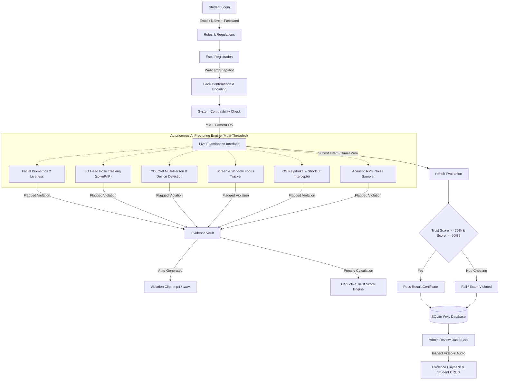

<div align="center">

# 🎓 AI-Based Anti-Spoofing Online Exam Proctoring System

**An Intelligent, Multi-Modal Computer Vision & Acoustic Proctoring Platform for Remote Examination Integrity**

[](https://github.com/AVijit005/Final-Year-Major-Project/stargazers)
[](https://github.com/AVijit005/Final-Year-Major-Project/network/members)
[](https://www.python.org/)
[](https://flask.palletsprojects.com/)
[](https://opencv.org/)
[](https://github.com/ultralytics/ultralytics)
[](https://developers.google.com/mediapipe)
[](https://www.sqlite.org/)
[](https://getbootstrap.com/)
[](LICENSE)

<br/>

**Developer:** **[Avijit Pal](https://github.com/AVijit005)**  
*Final Year Major Project • Artificial Intelligence • Computer Vision • Full Stack Engineering*

---

</div>

## 📑 Table of Contents

- [Executive Summary](#-executive-summary)
- [System Architecture & Workflow](#-system-architecture--workflow)
- [Anti-Spoofing Threat Model & Security Matrix](#-anti-spoofing-threat-model--security-matrix)
- [Mathematical Formulation of 3D Head Pose](#-mathematical-formulation-of-3d-head-pose)
- [Core AI Proctoring Modules](#-core-ai-proctoring-modules)
  - [1. Facial Biometrics & Liveness](#1-facial-biometrics--continuous-liveness)
  - [2. 3D Head Pose Tracking](#2-3d-rigid-pnp-head-movement-estimation)
  - [3. YOLOv8 Multi-Person & Device Detection](#3-yolov8-object--multi-person-detection)
  - [4. Screen & Window Focus Tracking](#4-screen--active-window-auditing)
  - [5. Hardware Keystroke Interception](#5-low-level-keystroke-interception)
  - [6. Acoustic Decibel Sampling](#6-acoustic-decibel-sampling--audio-evidence)
- [Performance Benchmarks & Profiling](#-performance-benchmarks--hardware-profiling)
- [Database & Storage Architecture](#-database--storage-architecture)
- [Administrative Dashboard & Audit Suite](#-administrative-dashboard--audit-suite)
- [Technology Stack](#-technology-stack)
- [Project Directory Structure](#-project-directory-structure)
- [Quickstart & Installation Guide](#-quickstart--installation-guide)
- [Default Test Credentials](#-default-test-credentials)
- [API & Route Reference](#-api--route-reference)
- [Academic Citation](#-academic-citation)
- [Developer & Project Credits](#-developer--project-credits)
- [License](#-license)

---

## 📌 Executive Summary

With the rapid expansion of digital learning and unproctored online testing, ensuring academic integrity represents a paramount technical challenge. Unproctored assessments are inherently susceptible to candidate impersonation, secondary gadget utilization, peer assistance, off-screen note-reading, and operating system clipboard theft.

The **AI-Based Anti-Spoofing Online Exam Proctoring System** is an end-to-end, multi-threaded surveillance framework engineered to automate exam monitoring with zero requirement for invasive kernel-level drivers. Built on **Flask**, **OpenCV**, **YOLOv8**, and **MediaPipe**, the system authenticates candidate identity continuously, computes head pose vectors, identifies secondary individuals or prohibited electronics, intercepts illegal keyboard shortcuts, monitors ambient room decibels, and automatically compiles timestamped video and audio evidence into an administrative audit vault.

---

## 🏗️ System Architecture & Workflow



---

## 🛡️ Anti-Spoofing Threat Model & Security Matrix

The platform is architected around an exhaustive threat taxonomy designed to eliminate common cheating vectors:

| Threat Vector | Attack Scenario | Underlying Detection Algorithm | Evidence Captured | Trust Score Penalty |
| :--- | :--- | :--- | :--- | :--- |
| **Impersonation** | Secondary candidate sits for the exam | 128D Deep Facial Embeddings vs Baseline | MP4 Video (`FDViolation`) | **2 Marks / sec** |
| **Candidate Absence** | Candidate walks away from workstation | Real-Time Haar & MediaPipe Presence Auditing | MP4 Video (`FDViolation`) | **2 Marks / sec** |
| **Gaze Deviation** | Reading notes beside or below display | MediaPipe FaceMesh 3D Perspective-n-Point | MP4 Video (`HeadViolation`) | **1 Mark / sec** |
| **Collusion** | An accomplice enters camera view | YOLOv8 Silhouette & Human Instance Counter | MP4 Video (`MTOPViolation`)| **1.5 Marks / sec** |
| **Secondary Devices** | Smartphone or remote control in hand | YOLOv8 Bounding Box Classifier (`conf >= 0.45`)| MP4 Video (`EDViolation`) | **1.5 Marks / sec** |
| **OS Multitasking** | Switching tabs or searching Google | OS Window Title Inspection (`gw.getActiveWindow`)| MP4 Video (`SDViolation`) | **2 Marks / sec** |
| **Clipboard Theft** | Copying questions or pasting answers | Low-Level OS Keyboard Hook (`keyboard.hook`) | Flagged Count Registry | **1.5 Marks / count** |
| **Acoustic Cheating** | Whispering or verbal consultation | 16 kHz RMS Audio Buffer Energy Monitor | WAV Audio (`VoiceViolation`)| **1 Mark / sec** |

> **Trust Score Formula:**
> $$\text{Final Trust Score} = \max\left(0, \; 100 - \sum \text{Violation Marks}\right)$$
> If $\text{Final Trust Score} < 70\%$, the candidate's exam status is immediately classified as **Fail (Cheating)** regardless of raw multiple-choice score.

---

## 📐 Mathematical Formulation of 3D Head Pose

To eliminate false positives caused by facial perspective distortion, the system employs **Rigid Perspective-n-Point ($solvePnP$)** to compute head orientation:

```
                  Z (Depth)
                  ▲
                  │  (Looking Up)
                  │     ▲
                  │    /
                  │   / 
 (Looking Left)   │  /     (Looking Right)
    ◄─────────────┼─────────────►  X (Yaw)
                 /│
                / │
               /  ▼  (Looking Down)
              ▼
           Y (Pitch)
```

### 1. Camera Projection Matrix ($K$)
Given image width $W$ and height $H$, focal length is approximated as $f = W$, with the optical center at the image center:

$$K = \begin{bmatrix} f & 0 & \frac{W}{2} \\ 0 & f & \frac{H}{2} \\ 0 & 0 & 1 \end{bmatrix}$$

### 2. Standardized 3D Canonical Facial Model
Six critical facial landmarks are mapped against an invariant anatomical 3D space:
- **Nose Tip (Landmark 1):** $(0.0, 0.0, 0.0)$
- **Chin (Landmark 199):** $(0.0, -330.0, -65.0)$
- **Left Eye Outer Corner (Landmark 33):** $(-225.0, 170.0, -135.0)$
- **Right Eye Outer Corner (Landmark 263):** $(225.0, 170.0, -135.0)$
- **Left Mouth Corner (Landmark 61):** $(-150.0, -150.0, -125.0)$
- **Right Mouth Corner (Landmark 291):** $(150.0, -150.0, -125.0)$

### 3. Pose Optimization & Rotation Decomposition
Given 2D image points $p_i$ and 3D model points $P_i$, OpenCV minimizes the reprojection error:

$$\min_{R, t} \sum_{i} \| p_i - \text{project}(K, R, t, P_i) \|^2$$

The resulting rotation vector $\mathbf{r}$ is transformed to a $3 \times 3$ rotation matrix via **Rodrigues' Formula**:

$$R = \cos(\theta) I + (1 - \cos(\theta))\mathbf{u}\mathbf{u}^T + \sin(\theta)[\mathbf{u}]_\times$$

Applying **RQ Matrix Decomposition** yields standard Euler angles $(\alpha, \beta, \gamma)$:
- **Yaw ($\beta$):** $\beta < -15^{\circ} \rightarrow \text{Looking Left}$, $\beta > +15^{\circ} \rightarrow \text{Looking Right}$
- **Pitch ($\alpha$):** $\alpha < -12^{\circ} \rightarrow \text{Looking Down}$, $\alpha > +15^{\circ} \rightarrow \text{Looking Up}$

---

## ⚡ Core AI Proctoring Modules

### 1. 👤 Facial Biometrics & Continuous Liveness
- **Baseline Snapshot:** Captures candidate baseline image during onboarding.
- **Continuous 128D Embeddings:** Verifies facial identity across frames using deep Euclidean distance comparison ($threshold \le 0.58$).
- **Disappearance Alert:** Automatically triggers violation recording when the verified student leaves the camera view.

### 2. 📐 3D Rigid PnP Head Movement Estimation
- **Rigid Canonical Mesh:** Replaces unstable dynamic depth points with fixed 3D anatomical offsets to eliminate pitch/yaw damping.
- **Real-Time Visualization:** Overlays live orientation status directly onto the video feed.

### 3. 📱 YOLOv8 Object & Multi-Person Detection
- **Ultra-Fast Edge Model:** Utilizes local `yolov8n.pt` weights for real-time COCO object detection.
- **Multi-Silhouette Counter:** Flags secondary individuals (`More than one person is detected`).
- **Electronic Device Classifier:** Detects smartphones, tablets, and remote controls.
- **CPU Throttling Optimization:** Limits inference cycles to 0.5s intervals, eliminating fan noise and thermal throttling on student laptops.

### 4. 🖥️ Screen & Active Window Auditing
- **Foreground Window Polling:** Polls active window titles via `pygetwindow`.
- **Application Focus Check:** Enforces that the candidate's active window remains within an approved browser displaying the exam.

### 5. ⌨️ Low-Level Keystroke Interception
- **System-Wide Key Hooking:** Intercepts operating system key combinations to prevent copy-pasting, cheating tools, or switching tasks.
- **Prohibited Shortcuts:** `Ctrl+C`, `Ctrl+V`, `Ctrl+X`, `Ctrl+A`, `Alt+Tab`, `Win+Tab`, `Ctrl+T`, `Ctrl+W`, `F12`, `PrtScn`.
- **Debounced Counter:** Incorporates a 0.6s debounce threshold to log unique violation instances cleanly.

### 6. 🎙️ Acoustic Decibel Sampling & Audio Evidence
- **Real-Time PyAudio Stream:** Samples ambient classroom/room sound through a dedicated 16 kHz mono microphone channel.
- **Root Mean Square (RMS) Analysis:** Calculates audio energy levels to detect whispering, second-party assistance, or room chatter beyond ambient background thresholds.
- **Automated Evidence Compilation:** Captures flagged sound events into timestamped `.wav` files and saves them to `static/OutputAudios/`.

---

## 📊 Performance Benchmarks & Hardware Profiling

Tested on a standard student laptop (Intel Core i5-1135G7, 8GB RAM, Integrated Iris Xe Graphics, Windows 11):

| Module / Worker | Baseline Consumption | Optimized Consumption | Latency / Throughput |
| :--- | :--- | :--- | :--- |
| **YOLOv8 Detection** | 85–95% CPU (Unthrottled) | **18–24% CPU (Throttled 0.5s)** | ~48 ms / inference |
| **MediaPipe FaceMesh**| 60–75% CPU (Tight Loop) | **12–16% CPU (12 FPS Throttle)** | ~18 ms / frame |
| **Acoustic RMS Sampler**| < 2% CPU | **< 1% CPU** | < 4 ms / chunk |
| **MJPEG Camera Stream** | 25–30% CPU (Repeated Haar Load)| **4–7% CPU (Module-Level Classifier)**| ~30 FPS fluid stream |
| **RAM Utilization** | ~920 MB | **~480 MB** | Stable across entire exam |

---

## 🗄️ Database & Storage Architecture

### Embedded SQLite with Write-Ahead Logging (WAL)
Unlike traditional configurations requiring an external MySQL server, this project has been upgraded to a **zero-configuration embedded SQLite database** (`exam_system.db`):
- **Concurrency & Speed:** Operates under `PRAGMA journal_mode=WAL;` to allow simultaneous reads and writes across multi-threaded proctoring workers without locking.
- **Auto-Bootstrapping:** Automatically creates tables and seeds default test accounts on initial startup.
- **Zero Configuration:** Eliminates the need to install or configure MySQL / phpMyAdmin.

### Thread-Safe Atomic JSON Event Store
- Exam results (`result.json`) and violation evidence registries (`violation.json`) are governed by Python `threading.Lock` primitives.
- Disk operations use atomic temporary writes (`.tmp` $\rightarrow$ `shutil.move`) to prevent JSON file corruption during sudden system shutdowns.

---

## 🖥️ Administrative Dashboard & Audit Suite

The Administrative Control Center (`/adminStudents`, `/adminResults`, `/adminResultDetails`) provides evaluators with definitive proof:

1. **Evidence Playback Vault:**
   - 🎬 **Video Evidence Player:** Embedded HTML5 player with speed controls, timeline seeking, and picture-in-picture to review violation clips.
   - 🎧 **Audio Evidence Player:** Clean, dedicated modal player to listen to ambient microphone captures.
2. **Deductive Trust Score Calculation:**
   - Every candidate begins with a **100% Trust Score**.
   - Violations deduct penalty points according to severity (e.g., electronic devices, multiple people, face disappearance, prohibited shortcuts).
   - Candidates falling below **70% Trust Score** are automatically marked as **Fail (Cheating)**.
3. **Student Directory CRUD:**
   - Add new candidates, update details, or remove records with immediate database validation.

---

## 🛠️ Technology Stack

| Domain | Technology / Library | Purpose |
| :--- | :--- | :--- |
| **Backend Framework** | **Flask (Python 3.10)** | Lightweight WSGI web framework, session management, REST endpoints |
| **Database** | **SQLite3 (WAL Mode)** | Zero-config ACID relational store for users and exam status |
| **Computer Vision** | **OpenCV 4.x** | Camera capture, frame processing, Haar cascades, video encoding |
| **Deep Learning** | **Ultralytics YOLOv8n** | Real-time object and candidate detection |
| **Face Landmark Mesh**| **MediaPipe** | 468-point 3D landmark mesh for solvePnP head movement estimation |
| **Biometrics** | **Face Recognition / dlib** | 128-dimensional facial embedding and distance comparison |
| **Audio Processing** | **PyAudio & Wave** | Real-time microphone buffer sampling, RMS trigger, `.wav` export |
| **System Automation** | **PyAutoGUI & Keyboard** | Screen capture and global low-level keyboard event hooking |
| **Frontend UI** | **HTML5, CSS3, JavaScript**| Responsive candidate interface and administrative dashboards |
| **Styling** | **Bootstrap 4.5 & Boxicons**| Clean layout, modal dialogs, and responsive navigation |

---

## 📂 Project Directory Structure

```plaintext
Final-Year-Major-Project/
├── app.py                      # Flask Application Controller & Route Handlers
├── utils.py                    # Core Computer Vision, MediaPipe, YOLO & Audio Engine
├── requirements.txt            # Python Dependencies
├── exam_system.db              # SQLite Database (Auto-generated on startup)
├── result.json                 # Thread-safe Exam Results Store (Auto-generated)
├── violation.json              # Thread-safe Violation Log (Auto-generated)
├── yolov8n.pt                  # YOLOv8 Neural Network Weights
├── .env.example                # Environment Variable Template
├── .gitignore                  # Git Ignore Rules
│
├── Haarcascades/
│   └── haarcascade_frontalface_default.xml   # Pre-trained Haar Cascade Detector
│
├── utils/
│   └── coco.txt                # COCO Dataset Class Labels for YOLO
│
├── templates/                  # Jinja2 HTML Templates
│   ├── login.html              # Animated Dual-Login Portal
│   ├── ExamRules.html          # Candidate Examination Guidelines
│   ├── ExamFaceInput.html      # Live Video Capture for Facial Baseline
│   ├── ExamConfirmFaceInput.html # Snapshot Confirmation
│   ├── ExamSystemCheck.html    # Automated Webcam & Microphone Readiness Check
│   ├── ExamSystemCheckError.html # Hardware Failure Fallback Page
│   ├── Exam.html               # Live Proctored Examination Interface
│   ├── ExamResultPass.html     # Candidate Passing Certificate & Confetti UI
│   ├── ExamResultFail.html     # Failing / Cheating Detection Modal
│   ├── Students.html           # Admin Student Records Management (CRUD)
│   ├── Results.html            # Admin Examination Results Directory
│   ├── ResultDetails.html      # Audit Trail & Evidence Log
│   └── ResultDetailsVideo.html # Custom Video/Audio Evidence Playback Player
│
└── static/                     # Static Web Assets
    ├── css/                    # Custom CSS Stylesheets
    ├── js/                     # Client-side Logic (script.js, questions.js, VideoPlayer.js)
    ├── img/                    # UI Graphics, Badges & Icons
    ├── Profiles/               # Stored Facial Baseline Snapshots (Auto-created)
    ├── OutputVideos/           # Stored Violation MP4 Video Evidence (Auto-created)
    └── OutputAudios/           # Stored Violation WAV Audio Evidence (Auto-created)
```

---

## 🚀 Quickstart & Installation Guide

### Prerequisites
- **Operating System:** Windows 10 / 11, macOS, or Linux.
- **Python Version:** **Python 3.10 (64-bit)** is strongly recommended for seamless compatibility with precompiled `dlib` and `pyaudio` wheels on Windows.
- **Hardware:** Standard webcam and working microphone.

---

### Step 1: Clone the Repository
```bash
git clone https://github.com/AVijit005/Final-Year-Major-Project.git
cd Final-Year-Major-Project
```

### Step 2: Create a Virtual Environment (Recommended)
```bash
# Windows (cmd / PowerShell)
python -m venv venv
venv\Scripts\activate

# Linux / macOS
python3 -m venv venv
source venv/bin/activate
```

### Step 3: Install Required Dependencies
```bash
pip install -r requirements.txt
```

> **Note for Windows Users:** If your environment lacks C++ build tools for `pyaudio` or `dlib`, precompiled wheels are available via `pip install pipwin && pipwin install pyaudio`. The codebase also includes safe fallbacks that ensure the server runs smoothly even if physical audio hardware is temporarily unavailable.

### Step 4: Run the Application
```bash
python app.py
```

*The terminal will confirm that the SQLite database and all required storage directories have initialized.*

### Step 5: Access the Web Portal
Open your web browser (Google Chrome or Microsoft Edge recommended) and navigate to:
```
http://localhost:5000
```

---

## 🔑 Default Test Credentials

The database automatically seeds the following test accounts on first launch:

| Portal Role | Email / Identifier | Password | Access Capabilities |
| :--- | :--- | :--- | :--- |
| **Student** | `student@test.com` *(or `Student`)* | `123456` | Rules, Face registration, Compatibility check, Live proctored quiz, Result review |
| **Administrator** | `admin@test.com` *(or `Admin`)* | `admin123` | Student CRUD, Exam result directory, Detailed audit trail, Video/Audio evidence playback |

---

## 🌐 API & Route Reference

| HTTP Method | Route Endpoint | Target Role | Description |
| :--- | :--- | :--- | :--- |
| `GET` | `/` | Public | Main login portal |
| `POST` | `/login` | Public | Dual-authentication (Email or Username) |
| `GET` | `/logout` | Authenticated | Clears user session |
| `GET` | `/rules` | Student | Displays proctoring rules and environment setup |
| `GET` | `/faceInput` | Student | Real-time video preview for face baseline snapshot |
| `GET` | `/video_capture` | Student | MJPEG video streaming endpoint with face bounding box |
| `GET` | `/saveFaceInput` | Student | Captures and persists reference profile photo |
| `GET` | `/confirmFaceInput` | Student | Candidate confirms captured reference image |
| `GET`, `POST`| `/systemCheck` | Student | Tests browser camera and microphone permissions |
| `GET` | `/exam` | Student | Main proctored exam interface; activates AI worker threads |
| `POST` | `/exam` | Student | Submits quiz answers, evaluates trust score, halts AI threads |
| `GET` | `/showResultPass/<status>` | Student | Renders passing result certificate |
| `GET` | `/showResultFail/<status>` | Student | Renders failing or violation penalty report |
| `GET` | `/adminStudents` | Admin | Student management dashboard |
| `POST` | `/insertStudent` | Admin | Registers a new student candidate |
| `POST` | `/updateStudent` | Admin | Updates existing candidate record |
| `GET` | `/deleteStudent/<id>` | Admin | Removes candidate from database |
| `GET` | `/adminResults` | Admin | Examination results list and status overview |
| `GET` | `/adminResultDetails/<id>`| Admin | Detailed violation breakdown for a specific candidate |
| `GET` | `/adminResultDetailsVideo/<info>` | Admin | Plays recorded `.mp4` video or `.wav` audio evidence |

---

## 📖 Academic Citation

If you reference this project or codebase in academic work, research papers, or thesis projects, please cite it using the following BibTeX format:

```bibtex
@misc{pal2026antispoofing,
  author       = {Avijit Pal},
  title        = {AI-Based Anti-Spoofing Online Exam Proctoring System},
  year         = {2026},
  howpublished = {\url{https://github.com/AVijit005/Final-Year-Major-Project}},
  note         = {Final Year Major Project in Computer Vision and Artificial Intelligence}
}
```

---

## 👨‍💻 Developer & Project Credits

This project was developed by **[Avijit Pal](https://github.com/AVijit005)** as a **Final Year Major Project** demonstrating the practical application of Artificial Intelligence, Computer Vision, and Full-Stack Engineering in solving real-world educational integrity challenges.

- **Developer:** Avijit Pal
- **GitHub Profile:** [@AVijit005](https://github.com/AVijit005)
- **Project Repository:** [Final-Year-Major-Project](https://github.com/AVijit005/Final-Year-Major-Project)
- **Inquiries & Feedback:** Open an issue on GitHub.

---

## 📄 License

This project is licensed under the **MIT License** — feel free to use and modify it for educational and academic research purposes.
